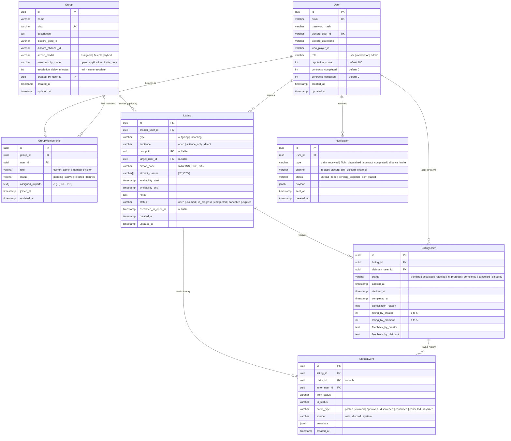
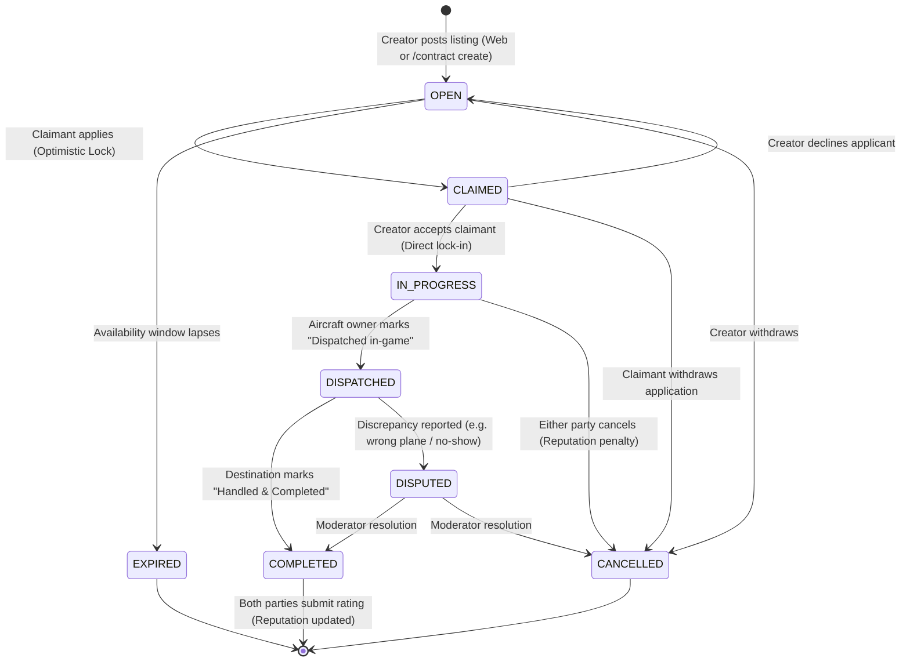
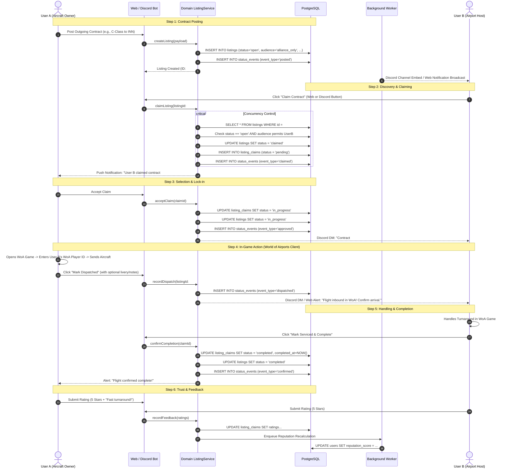
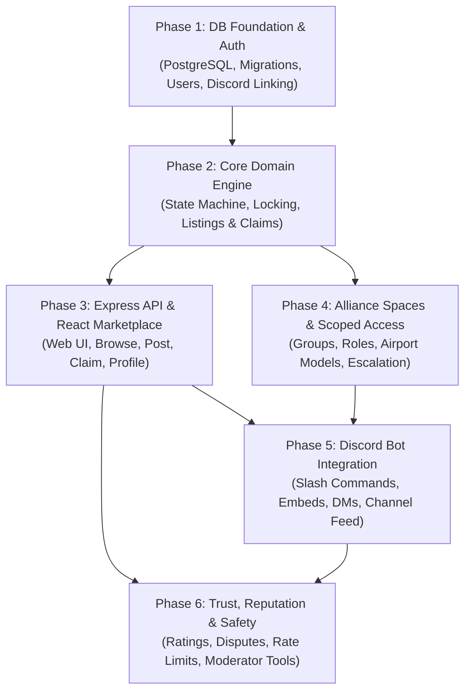

# WoA Contract Hub — Architecture Blueprint
**System Architecture, Domain Design, and Integration Patterns**

*Target Environment: Node.js / Express, PostgreSQL, React SPA, discord.js*  
*Team Size: 2–3 Developers*  
*Date: October 2026*

---

## Executive Summary & Architectural Drivers

World of Airports (WoA) is a mobile airport management game where player progression relies on peer-to-peer flight contracts ("connections"). However, Flyboys Games provides **no public game API**; all coordination, dispatching, and turnarounds must be self-reported by players. 

The **WoA Contract Hub** provides a unified marketplace and private alliance workspaces to eliminate fragmented coordination across forums, Discord threads, and Google Forms.

```
       +-------------------------------------------------------+
       |                  WoA Contract Hub                     |
       |  One Database  *  One Matching Engine  *  Dual Surfaces|
       +-------------------------------------------------------+
                /                                     \
               /                                       \
     +-------------------+                   +-------------------+
     |  React SPA (Web)  |                   | Discord Bot (d.js)|
     |  Primary Platform |                   | Push & Slash Cmds |
     +-------------------+                   +-------------------+
```

### Key Architectural Drivers

1. **Zero Split Liquidity**: Public players and organized alliance members operate on the **same underlying listing pool**, with access controlled via scoping rules rather than isolated database silos.
2. **Self-Reported Trust & Reputation**: With no game telemetry, the architecture treats contracts as an audited peer-to-peer escrow of commitments. State transitions are strictly verified and recorded in an immutable audit ledger (`status_events`).
3. **Lean Monolithic Footprint for 2–3 Devs**: Avoid microservice network boundaries and distributed transactions. Instead, implement a **Modular Monolith** with a shared domain core executed by co-located Express API and discord.js runtime workers over a single PostgreSQL database.
4. **Sub-3-Second Discord Deadlines**: Discord slash command interactions time out after 3,000ms. Bypassing HTTP loopbacks through direct domain service access guarantees instant interaction response and deferred updates.

---

## 1. Component Map

The system is architected as a **Modular Monolith with Shared Domain Services**. The web application and Discord bot act as peer entrypoints ("Driving Adapters" in Hexagonal Architecture) driving an identical domain core.

```mermaid
flowchart TB
    subgraph Clients["User Surfaces"]
        WebUser["Web Browser\n(React SPA)"]
        DiscordUser["Discord Client\n(Guilds & DMs)"]
    end

    subgraph Platform["WoA Contract Hub (Node.js Modular Monolith)"]
        subgraph WebLayer["Web Ingress (Express API)"]
            AuthRoutes["/api/auth/*"]
            ListingRoutes["/api/listings/*"]
            GroupRoutes["/api/groups/*"]
            UserRoutes["/api/users/*"]
        end

        subgraph BotLayer["Discord Ingress (discord.js Gateway)"]
            SlashHandler["Slash Commands\n(/contract, /alliance)"]
            ButtonHandler["Interaction Buttons\n(Claim, Accept, Dispatched)"]
            GuildEvents["Guild Member & Channel Sync"]
        end

        subgraph SharedCore["Shared Domain Service Layer"]
            ListingService["Listing & Claim Engine\n(State Machine & Locking)"]
            AccessControl["Audience & Scope Engine\n(Open vs Alliance Filter)"]
            GroupService["Alliance Management\n(Roles & Airport Models)"]
            ReputationEngine["Reputation & Trust Calc"]
            NotificationDispatcher["Notification Event Bus"]
        end

        subgraph WorkerLayer["Background Jobs (PgBoss Worker)"]
            EscalationWorker["Listing Escalation Worker"]
            ExpiryWorker["Listing Expiry Janitor"]
            DiscordNotifierWorker["Discord DM/Broadcast Worker"]
        end
    end

    subgraph DataStore["Persistence & Messaging"]
        PostgreSQL[("PostgreSQL 16+\n(Shared Database)")]
    end

    WebUser <-->|HTTPS / REST / JWT| WebLayer
    DiscordUser <-->|Discord WebSocket Gateway| BotLayer

    WebLayer --> SharedCore
    BotLayer --> SharedCore
    WorkerLayer --> SharedCore

    SharedCore <-->|Kysely / pg Pool\nTransactions & Row Locks| PostgreSQL
    WorkerLayer <-->|Job Queue Tables| PostgreSQL
    NotificationDispatcher -.->|Enqueue Event| WorkerLayer
    DiscordNotifierWorker -->|Discord REST API (Rate-Limited)| DiscordUser
```

### Component Breakdown & Responsibilities

| Component | Technology | Primary Responsibilities |
|---|---|---|
| **React Frontend SPA** | React 18+, Vite, TypeScript, Tailwind CSS | Client-side routing, user dashboard, marketplace filter matrix (airport, class, region), alliance workspace administration, dispute reporting UI. |
| **Express REST API** | Node.js, Express, TypeScript | Authentication (Email/Password + JWT, Discord OAuth2 linking), request validation (Zod), REST endpoints, session handling. |
| **Discord Bot Gateway** | discord.js (v14+), TypeScript | Long-lived WebSocket connection to Discord Gateway, handles slash commands, interactive embed buttons (e.g., "Claim Contract"), handles 3s ACK/deferrals. |
| **Shared Domain Services** | TypeScript Pure Services | Single source of truth for business rules: contract state transitions, transactional atomicity, audience scope query builders, reputation calculation. |
| **Job Queue & Workers** | PgBoss (Postgres-backed queue) | Lightweight background worker running inside the Node process. Handles scheduled listing escalations, auto-expirations, and batched Discord notifications without requiring Redis. |
| **PostgreSQL Database** | PostgreSQL 16 | Primary relational storage, ACID transactions, row-level concurrency locking (`SELECT ... FOR UPDATE`), partial indexes, and JSONB event payloads. |

### Process Topology & Deployment Model

For a team of 2–3 developers, operational simplicity is paramount:

```
+-----------------------------------------------------------+
| Single Docker Container / Process (Small Scale Prototype) |
|                                                           |
|  index.ts                                                 |
|   ├── startHttpServer()   -> Express listens on port 3000 |
|   ├── startDiscordBot()   -> discord.js logs into Gateway |
|   └── startJobWorkers()   -> PgBoss polls job queue       |
+-----------------------------------------------------------+
                             |
                             v
               +---------------------------+
               | Managed PostgreSQL (AWS   |
               | RDS / Supabase / Neon)    |
               +---------------------------+
```

* **Scaling Evolution**: When traffic grows, the codebase remains identical; simply deploy two container configurations using environment variables (`MODE=api` vs `MODE=bot_and_worker`).

---

## 2. Data Model

The data model centers around transactions, alliance boundaries, and an immutable status event log.



### Entity Data Dictionary & Invariants

#### 1. `users`
* Primary identity table.
* **Invariants**: `email` is unique. `discord_user_id` is unique when present (collected at registration or OAuth link). `reputation_score` default 100, updated asynchronously via `ReputationEngine`.

#### 2. `groups` (Alliances)
* Defines an alliance collective.
* `airport_model`:
  * `'assigned'`: Members claim exclusive stewardship of specific IATA hubs (e.g. User A owns `PRG`, User B owns `INN`).
  * `'flexible'`: Members claim any incoming or outgoing fleet announcement first-come-first-served.
  * `'hybrid'`: Core routes are assigned; surplus aircraft are flexible.
* `escalation_delay_minutes`: Number of minutes an alliance listing remains private before auto-qualifying for open marketplace visibility (e.g., 120 minutes). If `NULL`, listings remain strictly private.

#### 3. `group_memberships`
* Join table between `users` and `groups`.
* **Constraint**: `UNIQUE(group_id, user_id)`.
* `assigned_airports`: Array of airport IATA codes (`text[]`) managed by this member in `'assigned'` mode.
* `role`: `'owner'` (full control), `'admin'` (moderates members & listings), `'member'` (posts/claims group listings), `'visitor'` (read-only public hub access).

#### 4. `listings`
* Represents a flight connection contract offer or request.
* `type`:
  * `'outgoing'`: Creator owns an aircraft and offers to send it to a recipient's airport.
  * `'incoming'`: Creator owns an airport and requests other players to send planes to them.
* `audience`:
  * `'open'`: Visible and claimable by any registered player.
  * `'alliance_only'`: Visible and claimable only by active members of `group_id`.
  * `'direct'`: Reserved strictly for `target_user_id`.
* `escalated_to_open_at`: Timestamp when an alliance listing was promoted to the public market.
* **Database Indexes**:
  * `CREATE INDEX idx_listings_discovery ON listings(status, audience, airport_code) WHERE status = 'open';`
  * `CREATE INDEX idx_listings_group ON listings(group_id, status) WHERE group_id IS NOT NULL;`

#### 5. `listing_claims`
* Tracks the engagement between the listing creator and the claimant.
* **Concurrency Protection**: To prevent duplicate claims on single-aircraft contracts:
  * `CREATE UNIQUE INDEX idx_single_active_claim ON listing_claims(listing_id) WHERE status IN ('accepted', 'in_progress');`

#### 6. `status_events`
* Immutable append-only audit trail. Every transition in `listings.status` or `listing_claims.status` must emit a `status_events` record within the same PostgreSQL database transaction.
* Essential for disputes since game actions cannot be verified via API.

#### 7. `notifications`
* Central dispatch table for user notifications across in-app activity feeds and Discord DMs / announcements.

---

## 3. Core Contract Lifecycle Data Flow

Because World of Airports features **no external API**, the lifecycle is an escrow of commitments verified through bilateral self-reporting.

### Contract State Machine



### End-to-End Sequence: Posting to Completion

The diagram below illustrates the exact bilateral data flow from creation through game actions to rating:



---

## 4. Bot ↔ API Integration Pattern

A critical architectural decision for this system is whether the Discord bot should make HTTP REST calls into the Express API or communicate through a direct shared layer.

### Pattern Evaluation Matrix

```
Option A: Bot as HTTP Client          Option B: Raw DB Access in Bot        Option C: Shared Domain Service
                                                                            (RECOMMENDED)

+---------+     HTTP REST      +-----+     +---------+      Raw SQL       +-----+     +---------+     +---------+
| Discord | -----------------> | API |     | Discord | -----------------> | DB  |     | Express |     | Discord |
|   Bot   |                    +-----+     |   Bot   |                    +-----+     +----+----+     +----+----+
+---------+                       |        +---------+                       ^         \                 /
                                  v             +-----+      Raw SQL         |          \               /
                               +-----+          | API | ---------------------+           v             v
                               | DB  |          +-----+                               +-------------------+
                               +-----+                                                | Shared Domain Core|
                                                                                      +-------------------+
                                                                                                |
                                                                                                v
                                                                                           +---------+
                                                                                           |   DB    |
                                                                                           +---------+
```

| Criteria | Option A: Bot Calls REST API | Option B: Bot Directly Queries Raw DB | Option C: Shared Domain Services (Recommended) |
|---|---|---|---|
| **Discord 3-Second Timeout** | **High Risk**: HTTP connection latency, SSL handshakes, and serialization eat into the 3,000ms Discord interaction limit. | **Fast**: Direct query execution. | **Fastest**: Direct execution within same Node runtime or co-located process. Zero HTTP hop. |
| **Business Logic DRY** | **High**: Logic centralized in API controllers. | **Dangerous**: Logic split across Express routes and Discord command files. Inevitable divergence in validation or state rules. | **Highest**: All validation, state transitions, and authorization logic reside in a single shared TypeScript domain layer. |
| **Auth & Security Overhead** | **Complex**: Requires service accounts, bot API keys, or JWT token forgery to act on behalf of Discord users. | **Unsafe**: Bot must handle auth checks from scratch. | **Clean**: Context object `{ actorUserId, source: 'discord' \| 'web' }` passed directly into service functions. |
| **Operational Overhead (2–3 Devs)** | **Moderate**: Two services must be monitored, versioned, and kept in sync during deployment. | **Low but error-prone**: Difficult to maintain schema migrations cleanly across two codebases. | **Lowest**: Monorepo or single package. One migration runner, one deployment pipeline, zero network interface drift. |

### The Winning Pattern: Shared Domain Service Layer (Modular Monolith)

Both Express route handlers and discord.js interaction handlers act as thin **entrypoint adapters** that call the exact same underlying domain functions.

#### Concrete Implementation Example

```typescript
// ==========================================
// 1. SHARED DOMAIN SERVICE (src/core/services/listing.service.ts)
// ==========================================
export interface ExecutionContext {
  actorUserId: string;
  source: 'web' | 'discord';
}

export class ListingService {
  constructor(private db: DatabasePool) {}

  async claimListing(listingId: string, ctx: ExecutionContext): Promise<ClaimResult> {
    return await this.db.transaction(async (trx) => {
      // 1. Atomically lock listing row
      const listing = await trx
        .selectFrom('listings')
        .selectAll()
        .where('id', '=', listingId)
        .forUpdate()
        .executeTakeFirst();

      if (!listing) throw new NotFoundError('Listing not found');
      if (listing.status !== 'open') throw new ConflictError('Listing is no longer open');
      if (listing.creator_user_id === ctx.actorUserId) {
        throw new ValidationError('You cannot claim your own listing');
      }

      // 2. Enforce alliance audience access
      await AccessControlService.assertCanClaim(trx, listing, ctx.actorUserId);

      // 3. Mutate state
      await trx
        .updateTable('listings')
        .set({ status: 'claimed', updated_at: new Date() })
        .where('id', '=', listingId)
        .execute();

      const claim = await trx
        .insertInto('listing_claims')
        .values({
          listing_id: listingId,
          claimant_user_id: ctx.actorUserId,
          status: 'pending',
          applied_at: new Date()
        })
        .returningAll()
        .executeTakeFirstOrThrow();

      // 4. Append to immutable audit trail
      await trx
        .insertInto('status_events')
        .values({
          listing_id: listingId,
          claim_id: claim.id,
          actor_user_id: ctx.actorUserId,
          from_status: 'open',
          to_status: 'claimed',
          event_type: 'claimed',
          source: ctx.source,
          metadata: JSON.stringify({ claimantId: ctx.actorUserId })
        })
        .execute();

      return { listing, claim };
    });
  }
}

// ==========================================
// 2. EXPRESS ADAPTER (src/api/controllers/listing.controller.ts)
// ==========================================
export async function handleClaimListingHttp(req: Request, res: Response) {
  const result = await listingService.claimListing(req.params.id, {
    actorUserId: req.user.id, // Populated by JWT auth middleware
    source: 'web'
  });
  return res.status(200).json({ success: true, data: result });
}

// ==========================================
// 3. DISCORD BOT ADAPTER (src/bot/interactions/claim.button.ts)
// ==========================================
export async function handleClaimListingDiscord(interaction: ButtonInteraction) {
  // Acknowledge interaction within 3 seconds to avoid Discord timeout
  await interaction.deferReply({ ephemeral: true });

  // Map Discord Snowflake ID to Platform User ID
  const user = await userService.findByDiscordId(interaction.user.id);
  if (!user) {
    return interaction.editReply({
      content: '⚠️ Link your Discord account at https://woacontracts.com/link first!'
    });
  }

  const listingId = interaction.customId.replace('claim_', '');

  try {
    const result = await listingService.claimListing(listingId, {
      actorUserId: user.id,
      source: 'discord'
    });

    await interaction.editReply({
      content: `✅ Successfully claimed contract **#${result.listing.id.slice(0, 8)}**! The creator has been notified.`
    });
  } catch (err: any) {
    await interaction.editReply({ content: `❌ Could not claim: ${err.message}` });
  }
}
```

---

## 5. Alliance Scope & Access Control

The platform's primary market innovation is that **alliance listings and public listings share one database**, preventing split liquidity. Access control is enforced mathematically at the database query level.

### Listing Audience Matrix

| Listing Audience | Visibility Filter | Claim Permission |
|---|---|---|
| `'open'` | Public. All registered users and anonymous visitors. | Any registered user with a linked WoA Player ID. |
| `'alliance_only'` (Active) | Active members of `listings.group_id` with role in `['owner', 'admin', 'member']`. | Active members of `listings.group_id`. |
| `'alliance_only'` (Escalated) | **Promoted to Public**. Visible to all players once `escalated_to_open_at <= NOW()`. | Any registered user. |
| `'direct'` | Only `creator_user_id` and `target_user_id`. | Strictly `target_user_id`. |

### Enforcing Audience Scope in SQL Queries

To support high performance browsing with pagination, filtering, and indexing, audience filtering is implemented in a single unified SQL query using Common Table Expressions (CTEs) or `EXISTS` subqueries.

#### Optimized SQL Query (Kysely / Raw PostgreSQL)

```sql
-- Parameters:
-- $1 = current_user_id (NULL if visitor is not logged in)
-- $2 = airport_filter (e.g. 'INN', or NULL)
-- $3 = aircraft_class_filter (e.g. 'C', or NULL)
-- $4 = limit, $5 = offset

WITH user_alliances AS (
    -- Subquery evaluates active memberships for the requesting user once
    SELECT group_id 
    FROM group_memberships 
    WHERE user_id = $1 
      AND status = 'active'
)
SELECT 
    l.id,
    l.type,
    l.airport_code,
    l.aircraft_classes,
    l.audience,
    l.group_id,
    l.status,
    l.availability_start,
    l.availability_end,
    l.notes,
    l.created_at,
    u.discord_username AS creator_username,
    u.reputation_score AS creator_reputation,
    g.name AS group_name
FROM listings l
JOIN users u ON l.creator_user_id = u.id
LEFT JOIN groups g ON l.group_id = g.id
WHERE 
    l.status = 'open'
    AND (
        -- Condition 1: Public open listings
        l.audience = 'open'

        -- Condition 2: Escalated alliance listings whose timer expired
        OR (
            l.audience = 'alliance_only' 
            AND l.escalated_to_open_at IS NOT NULL 
            AND l.escalated_to_open_at <= CURRENT_TIMESTAMP
        )

        -- Condition 3: Alliance-only listings where user is an active member
        OR (
            $1 IS NOT NULL 
            AND l.audience = 'alliance_only' 
            AND l.group_id IN (SELECT group_id FROM user_alliances)
        )

        -- Condition 4: Direct invitations targeting this user
        OR (
            $1 IS NOT NULL 
            AND l.audience = 'direct' 
            AND (l.target_user_id = $1 OR l.creator_user_id = $1)
        )
    )
    -- Optional domain filters
    AND ($2::varchar IS NULL OR l.airport_code = $2)
    AND ($3::varchar IS NULL OR $3 = ANY(l.aircraft_classes))
ORDER BY l.created_at DESC
LIMIT $4 OFFSET $5;
```

### Architectural Choice: Query Builders vs. PostgreSQL Row-Level Security (RLS)

| Strategy | Advantages | Disadvantages | Verdict for 2–3 Devs |
|---|---|---|---|
| **Application Query Builder (Repository Helper)** | • Easy to write and test with Vitest/Jest.<br>• Transparent SQL logging during development.<br>• No database connection session switching needed. | • Developer must remember to call `withAudienceScope(query, user)`. | **RECOMMENDED PRIMARY**<br>Centralize scoping inside `ListingRepository.getVisibleListingsQuery()`. |
| **PostgreSQL Row-Level Security (RLS)** | • Guaranteed protection at the engine level.<br>• Impossible to bypass via forgotten `WHERE` clauses. | • Requires setting PostgreSQL session variables (`SET LOCAL app.current_user_id = ...`) per transaction.<br>• Harder to debug performance and index plans. | **Optional Defense-in-Depth** for production hardening later. |

### Automated Escalation Mechanics

To support the feature where private alliance listings spill over to the public marketplace if unclaimed:

1. When a user creates an alliance listing:
   ```typescript
   if (group.escalation_delay_minutes && group.escalation_delay_minutes > 0) {
     listing.escalated_to_open_at = new Date(Date.now() + group.escalation_delay_minutes * 60000);
   }
   ```
2. The listing remains visible only to alliance members while `NOW() < escalated_to_open_at`.
3. Once the timestamp passes, the SQL audience clause automatically includes it in public queries without requiring a batch update job.
4. A lightweight background worker runs every 5 minutes to broadcast newly escalated listings to general Discord channels:
   ```sql
   SELECT * FROM listings 
   WHERE audience = 'alliance_only' 
     AND escalated_to_open_at <= NOW() 
     AND escalated_broadcast_sent = FALSE;
   ```

---

## 6. Recommended Build Order

A small team of 2–3 developers cannot afford circular dependencies or blocking bottlenecks. The recommended implementation path is structured into 6 sequential phases where each phase produces a testable vertical slice.



### Detailed Phase Roadmap

#### Phase 1: Database Foundation & Identity (Sprint 1)
* **Goal**: Establish stable schema, CI/CD, and user identity.
* **Deliverables**:
  1. PostgreSQL schema migrations (Postgres 16, pg-migrate or Prisma/Kysely).
  2. Tables: `users`, `status_events`.
  3. Authentication: Email/password signup + JWT issuing.
  4. Mandatory Discord username capture + WoA Player ID field on profile.
  5. Automated integration test setup with testcontainers or local Postgres.
* **Dependencies**: None.

#### Phase 2: Core Domain Engine & Contract State Machine (Sprint 2)
* **Goal**: Build bulletproof transactional logic before building UI.
* **Deliverables**:
  1. Tables: `listings`, `listing_claims`, `status_events`.
  2. Implement `ListingService`: `createListing()`, `claimListing()`, `acceptClaim()`, `recordDispatch()`, `confirmCompletion()`, `cancelContract()`.
  3. Strict row locking (`SELECT FOR UPDATE`) and atomic state validations.
  4. Unit/integration tests simulating concurrent claims on the same listing (race condition tests).
* **Dependencies**: Requires Phase 1 (Users).

#### Phase 3: Express REST API & React SPA Marketplace (Sprint 3)
* **Goal**: Ship a fully functional public web marketplace.
* **Deliverables**:
  1. REST endpoints wrapping `ListingService`.
  2. React SPA: Filterable listings grid (airport code, aircraft class B/C/D, availability).
  3. User dashboard: "My Outgoing Flights", "My Inbound Turnarounds".
  4. Contract action buttons: "Dispatched", "Received", "Cancel".
  5. Deploy prototype to staging environment.
* **Dependencies**: Requires Phase 2 (Domain Engine).

#### Phase 4: Alliance Spaces & Scoped Access Engine (Sprint 4)
* **Goal**: Layer group organization on top of the open marketplace.
* **Deliverables**:
  1. Tables: `groups`, `group_memberships`.
  2. Role-based permissions: Owner, Admin, Member, Visitor.
  3. Airport model configuration: Assigned airports array vs Flexible exchange.
  4. Scoped query builder implementing the 4-part SQL audience filter.
  5. Alliance workspace view at `/alliances/:slug` with internal request boards.
  6. Escalation worker: Promote unclaimed alliance listings to public market after delay.
* **Dependencies**: Requires Phase 2 & Phase 3.

#### Phase 5: Discord Bot Integration (Sprint 5)
* **Goal**: Connect Discord community directly to the live platform.
* **Deliverables**:
  1. discord.js client initialization inside modular monolith.
  2. Slash commands:
     * `/contract create` (modal UI for airport, class, type).
     * `/contract find` (returns ephemeral list of matching listings).
     * `/contract status` (checks active flight commitments).
  3. Interactive message embeds with "Claim" and "Dispatched" buttons triggering `ListingService`.
  4. Discord notification dispatch worker: Direct Messages for status updates; automated channel announcements for alliance hubs.
* **Dependencies**: Requires Phase 3 (Marketplace) and Phase 4 (Alliances).

#### Phase 6: Trust, Reputation & Safety (Sprint 6)
* **Goal**: Provide dispute handling and quality assurance without game API telemetry.
* **Deliverables**:
  1. Post-contract bilateral rating UI (1–5 stars + review notes).
  2. Asynchronous `ReputationEngine` updating user scores based on completion ratio and rating averages.
  3. Dispute flagging workflow: Freezes reputation impact and triggers Admin dashboard alert.
  4. Rate-limiting middleware (express-rate-limit & Discord interaction quotas) to prevent spam.
* **Dependencies**: Requires Phase 3 & Phase 5.

---

## 7. Operational Best Practices for 2–3 Developers

1. **Monorepo Structure**: Keep frontend, backend, and bot in a single repository:
   ```
   woa-hub/
   ├── packages/
   │   ├── core/           # Shared domain types, DB schemas, and services
   │   ├── api/            # Express application & HTTP controllers
   │   ├── bot/            # discord.js client, slash commands, & handlers
   │   └── web/            # React SPA (Vite)
   ```
2. **Environment & Secrets**: Single `.env` file for development. Use a shared database instance in Docker for local parity.
3. **Graceful Degradation**: The Discord bot must be optional. If Discord Gateway experiences outages or rate limits, the web platform remains 100% operational.
4. **Structured Logging**: Use a lightweight logger (e.g., Pino) logging JSON with correlation IDs across HTTP requests and Discord interactions.
5. **Observability**: Track two critical platform metrics:
   * **Unfilled Contract Ratio**: How many listings expire without claims (signals liquidity gaps).
   * **Dispute Rate**: Percentage of claimed contracts requiring moderator intervention (signals bad actors or communication issues).
