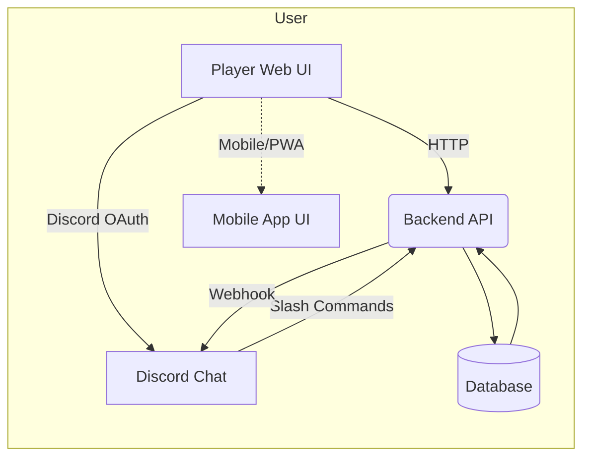

# Executive Summary

World of Airports (WoA) is a **community-driven** airport management game where players send and receive flights between airports run by others.  Its multiplayer **“connections”** system is central: players unlock larger airports and fleets over time, then leverage **player-to-player contracts** to earn XP/SP and in-game currency.  High-level players form *alliances* (cohorts managing networks of hubs) to coordinate flights.  However, current workflows (Discord chats, forum threads, Google forms) favor a few veteran operators and leave many new/mid-level players underserved. 

This report proposes a **shared platform** – a web/Discord-integrated service – to let any player **request or offer hosting at other players’ airports** in a structured way.  Drawing on WoA mechanics and community sources, we analyze existing alliance models and user segments, identify pain points (e.g. new players lacking connections, inactive hosts, trust gaps), and detail features like request/offer flows, matchmaking, reputation, scheduling and dispute handling.  We outline Discord bot integration (slash commands, OAuth linking, role sync), moderation and security, monetization/growth tactics, and a phased roadmap.  Tables compare feature trade-offs and competitor (alliance) offerings; Mermaid diagrams illustrate system architecture and key flows; and sample Discord bot commands show user interaction formats.  All claims and insights are supported by official WoA documentation, forum threads, and Discord developer policies. 

# World of Airports: Game Overview

**WoA** is a realistic airport management game.  Players **manage real-world airports** – handling ground services, turnarounds, aircraft liveries, and more.  The core multiplayer innovation is that **real players’ aircraft travel between airports run by other players**.  In practical terms: you operate Airport A and can accept flights sent from Airport B (run by another player), earning XP/SP (Silver Planes) and in-game money (wollars) for each serviced flight.  Similarly, you can send your *fleet aircraft* (purchased with premium “golden planes” (GP) or wollars) to other players to *start player contracts*.  Fleet flights give **5× the revenue** of non-player (AI) flights, accelerating growth.  

Key mechanics relevant here include:

- **Player Contracts:** These only appear once you accept a hosting offer or send to another player.  They start at Airport level ≥10 and yield significant XP/SP.  (By contrast, AI contracts start at level 1 and give smaller rewards.)  In practice, alliances or community exchanges let players jump-start these contracts early.  

- **Currency and Progression:** Players earn SP from contracts and convert SP into GP to unlock new airports or *“buy”* premium planes.  For example, converting SP into a GP lets you open a higher-tier airport (e.g. from IAD to HKG).  You can also spend GP on a plane to unlock its purchase with wollars, building a fleet to send to others.  

- **Contracts by Class and Region:** WoA classifies flights (e.g. B, C, D, … supereficient classes) by aircraft size/type.  Larger classes (e.g. A/B) at major airports give bigger rewards.  Players often specify which **classes and airports** they need help with (see Forum example requesting “Category C (and B)” flights to SAN).  

In short, WoA’s economy rewards **active multiplayer cooperation**.  Player-to-player connections yield the highest rewards, but require coordination.  Alliances have emerged to organize this (see next).  

# Community & Alliance Models

WoA’s official **community hubs** are its **Flyboys Games forum** and an (undocumented) official **Discord server**.  Nearly all players (5k+ members) use Discord and the Flyboys forum for discussion.  The forum has dedicated *Connections* and *Alliances* categories.  For example, the **Connections** forum lets anyone post requests (e.g. “*Looking for C-class contracts for SAN*”) and respond to others (e.g. “*Sent an A380, feel free to send back to my SYD later*”).  The official site and app descriptions emphasize this multiplayer linkage, but provide no in-app matching system – hence player-run channels handle it. 

**Discord:**  The World of Airports Discord (invite links often posted on Flyboys) is extremely active.  As of 2023 it had *thousands* of members.  It hosts channels for general chat, regions, and alliances.  Official developers sometimes answer questions there (e.g. contracts answered on Discord).  Discord’s real-time chat makes it faster to find flights, but information in transient chat can be hard to organize or search (users frequently ask for new invite links when old ones expire).  

**Flyboys Forum:**  The Flyboys community forum is the alternative hub.  It has categories like *Connections* and *Alliances*.  Players post structured connection requests (often using airport tags and plane classes).  For example, a thread “Looking for connections HKG” shows a player asking for anything and another sending a flight.  Forum threads provide persistent, searchable records of requests and offers.  However, responses can be slower (users note Discord “finds contracts faster”).  

**Alliances:**  Several player-run alliances have formed to organize contracts and progression.  They differ in structure:

- **One-Airport-per-Player (“Hub” model):** Many alliances (e.g. *International Wings Group (IAG)*) assign each member a specific airport.  Other members send flights into that airport on a schedule or queue.  The IAG forum has a special *INN Connections* category with hundreds of posts where users request or offer flights (e.g. “6x S-planes from INN available”) to coordinate at Innsbruck (INN).  In this model, each member “owns” an airport and regularly hosts planes from others.  Communication is via Discord or forum “group chat”.  This approach yields **many guaranteed contracts**, boosting XP quickly.  Downsides: it requires players to play frequently (to handle inbound flights) and often imposes branding rules (some alliances require specific liveries on some of your fleet).  

- **Free-Floating (“Flexi”) model:** Other alliances (e.g. *Flexi Alliance*) allow members to use *any* airport.  They use a “first-come” announcements system: members announce flight offers on Discord/forum and the first interested member takes it.  As Flexi’s lead explains, “players can use any airports and aren’t limited to one like others. We also don’t use Discord and messaging takes place in the forum itself”.  Flexi uses Google Forms to manage membership.  This model is more flexible for casual play, but coordination is more ad-hoc.  

- **Others:** Some alliances mix models.  For example, *Tranquility Alliance* and regional alliances exist (e.g. *Brazilian Alliance*).  Most set membership criteria (minimum playdays/week, plane counts).  All emphasize **XP/SP growth**: “an Alliance is an enormous enrichment of gameplay!”.  In practice, these groups manage connections via Discord text channels, forum threads or external docs.  

**Strengths/Weaknesses:** Alliances bring **trust and volume** – they pool fleets and enforce rules (e.g. livery colors) to reliably supply contracts.  The trade-off is **centralization**: it’s usually “the big players” controlling flows, and newcomers must join via application forms, channels, or be invited.  New or mid-level players often find themselves on the periphery (one user notes he “doesn’t have any free fleet” to contribute, delaying his alliance participation).  Active management (filling slots, moderating chat) can be burdensome.  Meanwhile, forums and Discord categories try to remain open to all, but lack matchmaking or reputation features. 

In sum, **current community models** rely on informal channels and manual processes.  This can work well for experienced groups, but leaves gaps: it’s **slow or opaque for new/mid players**, **trust is ad-hoc**, and there’s no integrated system for matchmaking, scheduling or disputes.  Our platform aims to complement these by providing a structured, open, and automated way to request and host flights, tightly integrated with Discord to leverage the existing audience.

# User Segments & Pain Points

We identify three broad player segments and their needs:

1. **New Players:** (Airport level ≲10, small fleet)  
   - *Needs:* Fast progress to unlock and staff larger airports (e.g. IAD, HKG).  They often lack any premium fleet to send, so rely on others.  They need **entry-level connections** (small/medium plane contracts) to build XP and SP.  They benefit from clear guidance and easy processes (many avoid Discord or complicated forms).  
   - *Pain Points:* Isolation and slow growth.  One beginner remarks that without an alliance, it’s hard to find player contracts.  Forum threads and Discord channels exist, but are fragmented.  Many new users don’t even know how to join Discord or where to post requests.  They may see high-tier forums (e.g. INN Connections) as intimidating.  Waiting for voluntary offers (e.g. free C-class planes on forums) can be unpredictable.  As one new user put it: “I’ve been playing this airport 8+ months and it’s starting to get really boring… I can accept anything” – illustrating the frustration of stall.  

2. **Mid-Level Players:** (Unlocked mid-tier airports, moderate fleet)  
   - *Needs:* Efficient scaling. By this stage they want sustained access to high-class contracts to maximize SP.  They may have started forming informal connections, but still lack a systematic way to fill slots.  They value reliability: known hosts to send to, and timely flights from others.  They may seek an alliance but have trouble getting attention from big alliance members.  
   - *Pain Points:* Inconsistency and complexity. The current model often means sending connection requests to multiple channels or forms with varying rules.  They may be accepted into an alliance only to find that core members are inactive (the “big players who don’t play actively” mentioned in the prompt).  Without transparent scheduling, flights might arrive at inconvenient times or be left unhandled.  The manual nature of forming requests (copying codes, posting in multiple Discord threads) is tedious.  Lack of a reputation system means trusting strangers; canceled or ignored requests are common but hard to track.  

3. **High-Rank/Inactive Players:** (Many airports, large fleets, occasional play)  
   - *Needs:* Often minimal. These players have already achieved top-tier status.  Some still participate by hosting flights (altruism or to keep their workforce busy).  They might occasionally seek specific connections for fun or events.  
   - *Pain Points:* Low engagement needs. They may prefer not to be flooded with trivial requests.  If anything, they need a simple way to signal availability (e.g. a “hosts wanted” post) rather than managing incessant demand.  

Overall, the **unmet needs** include: a unified interface for posting/finding connections (instead of juggling forum, Discord, forms), transparent scheduling (knowing when flights will occur), built-in verification/trust, and ability to manage mixed levels.  The new platform should be **accessible** (no Discord experience required) and **responsive** (quick matches), to engage newcomers and streamline mid-level growth, while still serving heavy users and communities.

# Competitive Analysis

We compare the proposed platform against existing alliance workflows and community channels.  Key dimensions include:

| Feature / Platform       | Informal Forum/Discord Requests | Alliance (Hub Model)    | Alliance (Flexi Model) | Proposed Platform                |
|--------------------------|-------------------------------|-------------------------|------------------------|----------------------------------|
| **Matching Mechanism**   | Manual posts/DMs; first-come  | Assigned airports; scheduled flows | Announced offers; first-come | Centralized matching with filters (airport, class, timing) |
| **Workflow**             | Unstructured, time-consuming  | Structured but rigid    | Semi-structured         | Guided flow (request → match → confirm) |
| **Incentives**           | Altruism, community spirit    | Rapid XP/SP growth      | Moderate growth, flexibility | Gamified points/reputation for hosts; easier XP access |
| **Governance**           | None (each user decides)      | Alliance leaders set rules | Alliance admins moderate chat | Platform policies (TOS, reporting); self-governed trust metrics |
| **Trust/Verification**   | Informal (usernames + word)   | Based on alliance screening (invite only) | Based on trust in chat    | Account linking (Discord/Game ID), verified tags, ratings |
| **Scale/Accessibility**  | Global but noisy; moderation-lite | Limited by alliance size; by-invitation only | Open but chat-limited | Broad, any player can join; filter by region/airport |
| **UI/UX**                | Discord text and forum posts  | Discord group chat and Google Docs (example: Flexi uses forum posts) | Similar | Dedicated web/mobile interface *plus* Discord bot commands |
| **Notifications**        | Manual (react to posts)       | Manual/push (e.g. Google form email?) | Manual (Discord pings)    | Automated (email/Discord notifications on matches) |
| **Scheduling**           | None (random times)           | Typically periodic "giveaway" events | None      | Integrated scheduling system (set preferred times) |
| **Analytics**            | None                           | None                    | None                   | Dashboard of stats (flights completed, active users, airport demands) |
| **Moderation/Spam Control** | Discord moderation; forum rules | Alliance vetting (forms) | Chat admins         | Platform moderation tools, captcha/ratelimiting (per Discord Dev Policy) |
| **Privacy/Security**     | Discord/Forum accounts        | Alliance leaders hold info (Google Form data) | Chat participants       | OAuth2 secure login (Discord); adherence to Discord Dev TOS (no data phishing) |
| **Mobile/Web Support**   | Indirect (Discord app, forum web) | Discord only           | Discord only           | Full web/mobile site *plus* Discord |

**Key observations:**  Existing solutions are **manual and siloed**.  A player seeking contracts must browse multiple chat threads or forum posts and coordinate by themselves.  Alliances improve volume and trust but at the cost of exclusivity and rigidity.  The proposed platform will unify these approaches: an **always-on matching engine with reliable protocol**.  For example, whereas the *INN Connections* forum requires manual post/reply (see “Connections” threads), our system could automatically suggest available hosts.  Unlike alliances’ one-airport rule or Flexi’s ad-hoc announcements, the platform will let players **specify preferences** (airport, plane class, times) and use an algorithm or peer matching.

# Platform Features & Design

The platform (“Contract Hub”) will be a **web/mobile application backed by a database and integrated with Discord**.  Its main features and properties include:

- **User Accounts & Authentication:**  
  Players sign up with an email or OAuth (Discord).  They **link** their WoA identity (in-game ID) to track their contract history.  OAuth2 with Discord lets users easily link accounts and optionally sync roles (e.g. alliance membership).  Verified status (from linking or admin review) earns a “Verified Host” badge to build trust.  

- **Request/Offer Workflow:**  
  A player seeking flights creates a *Request* specifying: target airport(s), contract class (e.g. “B-F passenger”), whether cargo or pax, time window, and optional notes.  This appears in a global (and filtered) **Requests board**.  Hosts can browse requests or get notified (e.g. by email or Discord) of relevant new requests.  To accept, a host claims the request, which triggers both parties: the requester’s account and Discord receive a confirmation.  (In-game, the host then manually sends a compatible plane at some time.)  Completed flights are marked in the platform to close the request.  

  *Offer flows:* Similarly, a player with a fleet can **offer flights** by listing available planes and desired airports.  The system can auto-match offers to pending requests, or let requesters browse offers.  

- **Matchmaking/Filtering:**  
  Users can filter requests/offers by region (continent, airport code), plane size, schedule (time zones), or alliance group.  The platform can implement intelligent matching (e.g. suggest nearby airports or reciprocal hosts) using metadata (e.g. GPS-based proximity, time zone).  Advanced matching might consider users’ play schedules, so hosts can find flights during their active periods.

- **Scheduling & Notifications:**  
  Each contract has a **scheduled window** (requester indicates desired timeframe).  Reminders/alerts are sent via Discord DM or push notifications when an accepted flight is approaching.  A calendar view or timeline dashboard shows confirmed incoming/outgoing flights.  This avoids leaving requests open indefinitely (unlike many forum posts).  

- **In-Game Currency Handling:**  
  The platform itself uses no real money.  All contracts are altruistic: hosts gain goodwill or reputation rather than in-game currency from the system (the actual game economy handles planes and revenues).  However, we can gamify by awarding *Platform Points* for completed contracts (e.g. 1 point per flight).  Points unlock profile badges or leaderboard status.  No payment is needed between players – all exchanges occur via the WoA game’s normal contract system.  

- **Reputation & Trust:**  
  Every user has a profile showing stats: total contracts requested, hosted, success rate, average response time, etc.  After each contract (once completed or canceled), both parties can optionally rate the experience or flag issues.  A “Reputation Score” (calculated from ratings and completion rate) is displayed.  This addresses trust: hosts with poor reliability can be identified, and requesters can prioritize trusted hosts.  Verified roles (Discord-linked users or administrators) earn extra trust.  

- **Verification & Security:**  
  To prevent abuses (e.g. multi-account spamming), users verify via Discord OAuth and/or by confirming a brief in-game test (our system could generate a code for them to enter as an airplane tag in game, though such API access may not exist; otherwise manual trust).  We strictly follow Discord’s dev rules: no password collection, no unsolicited messaging.  We won’t request any WoA credentials.  Privacy settings let users hide their email and only share needed info.  

- **Dispute Resolution:**  
  A basic dispute mechanism: if a host fails to send a promised flight, the requester can mark the contract as failed, adjusting scores.  Minor disputes (e.g. scheduling confusion) are handled by community moderation or “guild masters” volunteers.  Serious abuses (e.g. scam accounts) lead to bans.  Because all flights still happen in-game, our system’s recourse is limited to reputation.  We will provide warnings about fair play and reference to WoA’s own TOS for real-money scams.  

- **Analytics Dashboard:**  
  Admins see metrics (requests per airport, active users, fulfillment rates).  Users see their own history.  Statistics (e.g. “top 5 most requested airports this month”) help the community find needs.  

- **Cross-Platform UX:**  
  A responsive web app will let users post/browse via browser or mobile.  The UI will support quick posting (copy user airport code with one click, intuitive plane-class selectors).  For power users, a lightweight mobile app or PWA could allow on-the-go management.  All interface elements (forms, lists) should be brief and focused – long text or manual posting (like in forums) is avoided.

- **Bots & Webhooks:**  
  A dedicated **Discord Bot** will serve as the in-chat interface (see next section).  Webhooks will push platform updates into Discord channels (e.g. “New Contract Request in Europe”).  Conversely, commands on Discord will trigger API calls to the platform (e.g. `/request` on Discord creates a request in our database).  

- **Privacy & Rate Limits:**  
  We comply with Discord’s policies: users may only be contacted if they opted in, and no ads or external marketing will be sent.  The bot will enforce rate limits on commands (to avoid abuse and hit Discord’s API limits).  All user data is stored securely (encrypted in transit) and only necessary fields (Discord ID, WoA code) are kept.  The platform will enforce age restrictions per Discord rules (Discord users must be 13+).  

- **Moderation & Safety:**  
  Beyond Discord policies, the platform will have community guidelines (e.g. no hate or harassment).  Admin/moderator roles (possibly drawn from trusted WoA community volunteers) can suspend or block users violating rules.  Automated spam detection (e.g. repeating requests, profanity filters) will flag content for review.  

- **Scalability:**  
  We anticipate growth as the WoA audience (~millions) is large.  The backend will use scalable cloud services (e.g. AWS/GCP servers, a cloud database).  Horizontal scaling (multiple bot instances) will handle concurrent Discord interactions.  Caching and stateless design will ensure we can handle spikes (e.g. after big WoA updates or Discord activity peaks).

# Discord Integration Design

Given WoA’s Discord-centric community, deep integration is essential.  Key design points:

- **Bot Features & Commands:**  
  We’ll create a Discord bot (verified via the [Discord Developer Portal](https://discord.com/developers)) to handle contract requests within chat.  Users can use slash commands such as `/request`, `/find`, `/accept`, `/cancel`, `/status`.  For example:
  ```  
  /request airport IAD class C "Need cargo flights to level up!"
  ```
  The bot will respond (ephemerally) with a confirmation and link to view the full request online.  It will also post a summary message in a designated #requests channel, e.g.:
  > **New Request [#1234]:** *User123* needs C-class cargo flights **to IAD**. Use `/accept 1234` to take this request.  
  If another player types `/accept 1234`, the bot will update the request status, DM both users (requester: “Your request has been accepted by *UserXYZ*.”; acceptor: “You’ve accepted request #1234. Please send the flight via game.”).  

  The bot will also support `/my-requests` to list a user’s active requests, `/help`, etc.  Buttons and embeds will be used for clarity.  

- **Slash Command Integration:**  
  Discord’s modern interactions model allows slash commands and message components.  We will define commands in our Discord application manifest, so users can invoke them in any server (subject to scopes).  Commands will validate arguments (airport codes, plane classes) and call our backend API.  As an example message format:  

  > **User:** `/status`  
  > **Bot (DM):** *“You have 3 active requests: #45 (INN, awaiting host), #47 (LHR, accepted by *AeroApollo*), #48 (BKK, no host yet).”*  

- **OAuth2 Linking:**  
  We will use Discord OAuth2 to log users into our platform.  Once a user joins the official WoA Discord, they can click an authorization link to log in to the site with their Discord account.  This obtains their Discord ID and (optionally) server roles.  On the platform side, we link their WoA player ID.  This ensures only legitimate players operate and lets us DM them via the bot.  It also allows a one-click setup: clicking a special link in Discord leads them to the web with auto-login.  

- **Role Sync & Invite Flows:**  
  If WoA alliances want to adopt the platform, their Discord roles could be synced (e.g. Alliance members get a special tag on the site).  For example, being in the *Flexi Alliance* Discord role could automatically grant access to a private Flexi channel on the platform.  Conversely, inviting someone via our site could automatically add them to a Discord role (with their permission), easing onboarding.  Invitation flows will respect privacy – users must explicitly authorize adding server roles.  

- **Notifications & Channels:**  
  The bot will post notifications in specific Discord channels.  For instance, global “#woa-requests” channel shows all new requests (tagged by region/airport: Asia, Europe, etc.), while separate channels (e.g. #requests-IAD) can receive filtered posts.  Hosts who join a channel (or subscribe) get pinged on matching requests.  Likewise, major announcements (e.g. platform updates) go to an #announcements channel.  The bot will handle invites: if a Discord invite link is clicked, users can be guided to register on the platform.  

- **Anti-Spam & Rate Limiting:**  
  We adhere to Discord’s Developer Policy: no unsolicited messages, no ad spamming.  The bot will not DM users without prior interaction (requests and acceptances count as interaction).  Slash commands are used to avoid spamming channels.  The platform enforces per-user rate limits (e.g. max 5 requests per day) to prevent flooding.  On Discord, the bot’s message rate respects Discord’s API limits (we’ll throttle as needed).  Captchas on the web can block bots.  

- **Message Formats:**  
  We will use rich embeds and emojis for clarity.  Example bot flow:  

  - *User posts:* `/request BKK E "Cargo flights, high reward"`  
    *Bot DM:* “Request #202 created for BKK (Class E). Link: [View Request](#). Others can accept with `/accept 202`.”  
    *Bot (in #asia-requests):* “✈️ **New Request [#202]**: *UserABC* needs **E-class cargo flights to BKK**. // Use `/accept 202` to take this flight.”  

  - *User:* `/accept 202`  
    *Bot DM (to Host):* “You accepted Request #202 (BKK, Class E). Please send an E-class plane and handle it. Contact *UserABC* if needed.”  
    *Bot DM (to Requester):* “Your request #202 has been accepted by *UserHost*. They will send a flight shortly.”  

  These examples show concise communication.  Buttons (e.g. “View Request”) and user mentions ensure clarity.  All Discord actions are optional – users can also use the web UI for full details.

# Monetization & Growth

**User Acquisition:** We will leverage existing channels.  Announce on WoA’s Flyboys forum and Discord about the platform (e.g. pinned posts, new user guide).  Partner with influential alliances or content creators to spread the word.  Implement seamless on-boarding: e.g. a link in Discord “type `/request` to get started” or “register here to unlock advanced matching”.  In-app game announcements (if possible) could redirect to our site.  

**Retention & Engagement:** 
- **Onboarding:** Provide a tutorial or guide for new users (possibly a Discord bot walkthrough or forum FAQ).  Show quick wins by recommending popular airports or auto-joined requests.  
- **Gamification:** Award points/badges for first request, 10 flights hosted, etc.  Leaderboards (e.g. top hosts or fastest responders) encourage activity.  
- **Notifications:** Timely alerts (e.g. “Someone accepted your request”) keep players returning.  Weekly email digests or Discord summaries (“50 new requests in Europe this week”) can re-engage lurkers.  
- **Community Features:** Chat features on the platform or embedded Discord widget for Q&A.  User testimonials or stories (e.g. “How I reached IAD thanks to our platform”) to build community spirit.

**Monetization:** The platform itself need not charge users.  Possible revenue models: 
- **Ads or Sponsorships:** Non-intrusive ads (e.g. a banner for aviation hardware) or sponsored messages (if permitted by Discord policy) could offset costs, but must not annoy users. 
- **Premium Features:** Perhaps a subscription unlocks advanced stats or unlimited requests.  If we offer paid features, Discord’s Premium Apps program requires we support in-Discord purchases.  
- **Partnerships:** Team up with the WoA developers (Flyboys) for an official endorsement or integration (e.g. an API hook).  Possibly integrate with related aviation community sites or esports events.  

Growth also comes from network effects: as more players use the platform, it becomes more valuable, attracting still more players.  We’ll measure CAC (cost per acquired user via ads/forums) vs LTV (user retention and engagement) to optimize efforts.  

# Implementation Roadmap & KPIs

We propose a phased implementation with milestones:

1. **Prototype (1–2 months):**  
   - Build minimal web UI for posting requests/offers (airport, plane class).  
   - Simple backend (e.g. Node.js + PostgreSQL) to store requests and users.  
   - Basic Discord bot to listen for a few slash commands (`/request`, `/accept`, `/list`).  
   - Manual OAuth2 integration with Discord.  
   - **Effort:** Low (small dev team, off-the-shelf frameworks).  
   - **KPI:** Working end-to-end request cycle (web↔Discord). 50 beta users on platform.  

2. **MVP (3–6 months):**  
   - Complete core flows: matchmaking filters, notifications (Discord DM/web push), reputation tracking.  
   - Public launch integration with Flyboys forum and Discord announcements.  
   - Moderate UI polish (React or Vue web app + mobile responsiveness).  
   - **Effort:** Medium (front-end development, security review).  
   - **KPI:** 500–1000 users active, 1000+ contracts arranged. 70% successful contract completion rate.

3. **Scaling & Features (6–12 months):**  
   - Add advanced features: scheduling calendar, analytics dashboard, mobile app (if needed).  
   - Implement moderation tools, dispute workflow, and robust OAuth role sync.  
   - Possibly integrate with game APIs (if available) to verify contract completion automatically.  
   - **Effort:** High (DevOps, advanced features).  
   - **KPI:** 5k+ users, retention rate (Day30) ≥20%, high NPS score in user surveys.

4. **Optimization (12+ months):**  
   - Optimize performance (caching, load testing) for peak loads.  
   - Explore additional gamification or monetization (subscriptions, partnerships).  
   - Iterate based on user feedback.  
   - **Effort:** Ongoing refinement.  
   - **KPI:** Sustained growth (monthly active users up 10%+), healthy host/request ratio (e.g. average fulfillment time <24h).

**Tech Stack Options:**  
- **Backend:** Node.js/Express or Python/Django (both have good Discord libraries) with PostgreSQL or MongoDB.  
- **Bot:** Node.js (discord.js) or Python (discord.py) – both well-documented.  
- **Frontend:** React or Vue for web; optional React Native or Flutter for mobile.  
- **Hosting:** AWS/GCP (EC2 or App Engine) with container orchestration (Docker/Kubernetes) for scalability.  
- **Estimated Costs:** Cloud hosting (small instance ~$50/mo initially, scaling to $200+ as users grow); domain + SSL; minimal fees for OAuth app.  Development cost depends on team salary; a small 2-3 person team could prototype for <\$50K.  

# Tables, User Journeys, Diagrams

**Feature Trade-Offs:** For example, deciding between *manual requests* vs *automated matching*:

| Design Choice                   | Pros                                        | Cons                                      | Examples                     |
|---------------------------------|---------------------------------------------|-------------------------------------------|------------------------------|
| Manual posts (forum/Discord)    | Simple; low dev cost                        | Slow; inconsistent; hard to search        | Existing Flyboys threads     |
| Automated matching engine       | Fast; scalable; transparent to user         | More complex to build; risk of errors     | Proposed platform’s matcher  |
| One-airport alliances (rigid)   | Predictable, high volume                    | Inflexible; barrier to entry for newbies  | IAG model     |
| Flexible invitations (queue)    | More open; casual recruitment               | Chaotic; first-come luck; possible spam   | Flexi Alliance  |
| Discord-only (chat-based UI)    | Real-time, familiar UI for community        | No long-term record; fragmentary          | Current system, high speed |
| Web platform + Discord bot      | Combines persistence with real-time chat    | User must manage two interfaces           | Proposed solution (this plan)|
| Incentive: reputation badges    | Encourages good behavior                    | Might be gamed (multi-accounts)           | —                            |
| Incentive: in-game rewards (nonexistent) | Not applicable (no currency exchange) | Could violate game TOS (if any reward)    | —                            |

**User Journey (New Player):**  

| Step                        | Action                                 | Touchpoint              | Outcome / Note                                          |
|-----------------------------|----------------------------------------|-------------------------|---------------------------------------------------------|
| **1. Discover platform**     | Sees Flyboys/Discord announcement with invite link | Flyboys forum or Discord | Clicks link to register; logs in via Discord OAuth       |
| **2. Link WoA ID**          | Enters in-game ID “Player_1234”        | Web UI                  | Profile created (now can request/offer)                 |
| **3. Post request**         | Fills form: “Request 3 C-class to PRG” | Web UI or Discord `/request` | Request appears on board; bot posts to Discord channels |
| **4. Matching**             | Host (another player) sees request and accepts | Web UI/Discord Bot    | Both get confirmation (DM from bot, site notification)  |
| **5. Flight execution**     | Host sends plane in WoA; requestor accepts in WoA | Game itself (WoA)   | (Flight completed, XP/SP earned)                        |
| **6. Close request**        | Mark as completed/cancelled           | Web UI                  | Reputation updated; points awarded; record on dashboard |
| **7. Repeat / Engage**      | Repeats flow for further airports/contracts; explores offers | Platform/Discord    | Gains badges; shares link with friends (growth)         |

**Competitor Feature Matrix:**  

| Feature                     | Alliance (e.g. IAG)   | Public Forum/Discord | Proposed Platform   |
|-----------------------------|-----------------------|----------------------|---------------------|
| **Ease of Use**             | Medium (apply + schedule) | Low (multiple channels) | High (single interface) |
| **Automation**              | None                  | None                 | High (search/filter) |
| **Trust/Verification**      | High (invites only)   | Low (anonymous posts) | Moderate (OAuth, ratings) |
| **Transparency (who’s hosting)** | Medium (leaders)    | Low (ad-hoc)         | High (profiles + availability) |
| **Scheduling**              | Formal (events)       | None                 | Yes (built-in calendar) |
| **Scale**                   | Limited by admins     | Unbounded but chaotic| Scalable; global       |
| **Incentive Management**    | Alliance rules        | None                 | Platform points/badges |
| **Cross-Platform (mobile)** | Discord app only      | Discord/forum apps   | Full responsive web / app |


**Figure:** System architecture overview. Players interact via a web/mobile UI or Discord (bots).  The backend handles API logic and uses a database.  The Discord bot communicates via API/webhooks.

```mermaid
sequenceDiagram
  participant U as User
  participant B as Bot
  participant S as Server
  Note over U: 1. User issues `/request`
  U->>B: `/request HKG C "Cargo needed"`
  B->>S: CreateRequest(UserID, "HKG", "C")
  S->>DB: Insert request record
  DB-->>S: Success
  S->>B: {requestID:101, status:"open"}
  B->>U: "Request #101 created. Other players can `/accept 101`."
  B->>#requests: "✈️ **New Request [#101]**: *UserA* needs **C-class cargo to HKG**. Use `/accept 101` to take."
  Note over B: 2. Someone accepts
  U2->>B: `/accept 101`
  B->>S: AcceptRequest(101, User2ID)
  S->>DB: Update request (accepted by User2)
  S->>B: {status:"accepted"}
  B->>U: "You accepted #101. Please send an appropriate plane."
  B->>U2: "Your request #101 was accepted by *User2*. They will send a flight soon."
```
**Figure:** Key flow for creating and accepting a request via Discord commands. The bot mediates between users and the server.

# Discord Bot Message Examples

To illustrate the UX, here are sample chat interactions (formatted as they would appear):

- **Posting a Request:**  
  **User:** `/request PDH C "Looking for C-class passenger flights to boost SP."`  
  **Bot (DM to user):** `✅ Request #345 created for **PDH** (Class C). You’ll be notified when someone accepts it.`  
  **Bot (Public in #requests-asia):** `✈️ **New Request [#345]**: @UserXYZ needs **C-class passengers to PDH**. To accept, type \`/accept 345\`.`  

- **Accepting a Request:**  
  **User:** `/accept 345`  
  **Bot (DM to acceptor):** `👍 You accepted request #345 (C-class to PDH). Send the plane at your earliest convenience.`  
  **Bot (DM to requester):** `🎉 Your request #345 has been accepted by @HostUser. They will send a flight to PDH soon.`  

- **Viewing Status:**  
  **User:** `/status`  
  **Bot (DM to user):** `📋 Your active requests:\n• [#345] PDH (Class C) — **Accepted by @HostUser**\n• [#346] SYD (Class D) — **No takers yet**\nPress the arrow for more info.`  

Buttons and embeds (not shown) would include “View in App” links or maps of airports. All messages comply with Discord policy (no unsolicited DMs beyond these interactions).

# Conclusion

The **shared contract-platform** bridges gaps in WoA’s ecosystem by combining the **community reach of Discord** with a **structured matching system**.  Its features (request flows, matchmaking, reputation) directly tackle pain points faced by new/mid players.  Compared to alliances’ ad-hoc methods, the platform offers transparency, automation and broad accessibility.  It will coexist with existing communities (integrating into Discord) and enhance them rather than replacing.  By following Discord’s developer guidelines and WoA’s multiplayer model, the platform can safely and effectively grow into the game’s community, helping players of all levels connect, cooperate, and enjoy the game more fully.

**Sources:** Official WoA documentation and community forums describe the game’s mechanics and alliance workflows.  Discord developer terms and policy inform integration requirements.  (No Discord server images are shown, but reference [86] documents the community size.)

